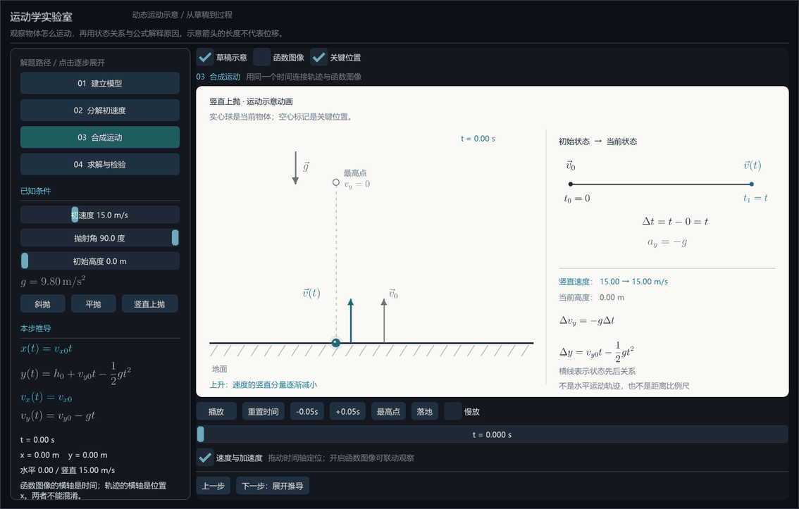
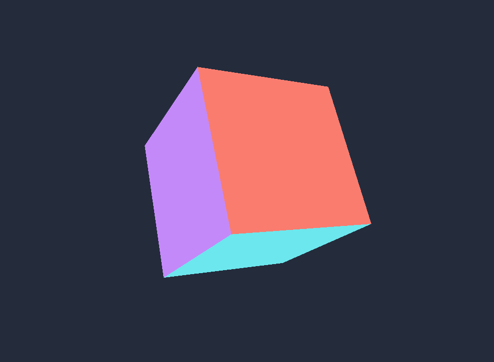

# Vulkan + C++ 图形实验

这是用于学习和尝试的 C++ / Vulkan 项目，目前包含：

- `01_cube`：可旋转彩色立方体，学习三维变换与深度测试。
- **`02_kinematics`：运动示意动画 demo**，以草稿式场景表现抛体运动，配合 LaTeX 公式和可选的函数图像。
- **`physics_editor`：物理示意编辑器 v0.4**，编辑图元、运动和解题步骤；支持参数化组件、独立历史、公式/关键帧动画及独立工程，支持运行时 LaTeX、整体缩放与 PNG/MP4/GIF 导出，并通过 MCP 操作原生窗口。

MCP 编辑默认同步显示/恢复原生窗口；右侧“操作日志”栏记录本会话实际发生过的界面/MCP 请求（可按来源与失败筛选，F9 开合），底部“编辑历史”才是可回退的文档修订，两者互不影响；磁盘上的会话审计仍逐行写入 `history/`。

## 物理示意编辑器

```powershell
.\run-editor.ps1                                  # 增量编译 Release 后启动（推荐入口）
.\run-editor.ps1 -DebugBuild
.\run-editor.ps1 -Project .\path\to\example.physproj
```

`run-editor.ps1` 先调用共用构建入口 `build-editor.ps1`：按 checked-in `vs2022` 预设配置，再用 `release`（或 `debug`）构建预设增量编译 `physics_editor`，成功后才启动固定的 `build/vs2022/bin/editor/<配置>/physics_editor.exe`。构建失败会立即停止并提示先保存、关闭已打开的编辑器窗口，不会退回旧的可执行文件，也不会自动结束进程。Debug 与 Release 是同一份源码的两个配置，等价的显式命令是：

```powershell
cmake --preset vs2022
cmake --build --preset release --target physics_editor
```

`build/verify-runtime` 是历史验证用过的临时独立构建目录，不是日常入口。MCP 接入推荐 `.\run-editor-mcp.ps1`：同样先增量构建，再以 stdio 传输启动服务，构建与诊断只写标准错误，stdout 仅承载 MCP 协议。

[公式与导出](docs/runtime-formulas-and-export.md) · [动画工作区与独立工程](docs/animation-and-projects.md) · [编辑器使用与 MCP 接入](docs/editor.md) · [架构和扩展方式](docs/editor-architecture.md) · [参数化组件与历史回溯](docs/components-and-history.md)


通过“示例 → 斜面接圆弧”，修改 R、L、angle 验证相切与同高关系。组件草稿与主场景分别撤销，发布定义才更新主场景。轨道动力学求解尚未实现。

文字与公式支持 **Write 手写入场**：“示例 → 手写入场（中文 + 公式）”或导入 `scenes/write-entry.json`，播放时字形沿**真实覆盖轮廓**逐步描绘，随后淡入填充（`write` 字段可配置开始时间 / 时长 / 逐字错开 / 描边与填充占比）。轮廓来自字形覆盖掩码的连通区域，不是字体矢量路径，因此中文按墨迹区域从上到下、从左到右描绘，**不是汉字真实笔顺**。公式改为按**结构/字形顺序**书写：分式先分数线、再分子、再分母（嵌套递归），外层从左到右（`flight` 先 `T` 后 `=`），底数后紧跟上下标，根号与被开方结构连续；该顺序来自与遮罩同源的 PDF，作为可选 `writingPlan` 随公式资产保存，缺失或对不上时回退阅读序。未设置 `write` 的旧工程渲染完全不变，动画结束后逐像素等同原字形。详见 [编辑器使用](docs/editor.md#write-手写入场)。

上一轮已修复视图操作误报未保存、颜色拖动产生多条历史、下标缺字无提示等问题，并改进高分辨率文字导出。支持查询画布视图、匹配画布尺寸或独立取景导出，以及 stdio 接入；超过 3600 帧会明确拒绝。专项验收覆盖缺字、2K 导出、未显示组件导出、工程加载和超帧拒绝。当前改动新增右侧“操作日志”与导出实时进度、阶段、预计剩余和取消；性能倍数与最终验收数据以 [验证记录](docs/verification.md) 为准（本轮数据待补充）。

已知限制：高倍放大仍可能使位图文字和公式变软；组件实例缩放不改变字号；中文与数学公式需分别使用文字和公式图元。窗口布局只在本机验证，未覆盖完整 DPI 矩阵；新增 MCP 工具可能需要刷新或重连。完整状态见 [编辑器缺陷验收清单](docs/reviews/2026-09-10-editor-defects.md)。

长期维护入口：[开发约定](docs/development.md) · [开发计划](docs/roadmap.md) · [变更日志](docs/changelog.md) · [设计决策](docs/decisions/0001-components-and-history.md)。项目已使用本地 Git 记录基线和后续变更，未配置远程发布。

## 当前 demo：运动学实验室

```powershell
.\build\vs2022\bin\02_kinematics\Release\vulkan_kinematics.exe
```

启动即播放竖直上抛的草稿式运动示意动画：地面、小球、速度箭头、重力方向和两个时刻的状态对照。空格暂停；可拖动时间轴，或使用“最高点”“落地”定位。勾选“函数图像”展开曲线，取消“草稿示意”切回原坐标视图。左侧仍可按四个解题步骤展开，参数与三种抛体预设仍可调整。

这是一个具体题型的可视化原型；先验证教学效果，再决定如何封装。没有自然语言题目解析或通用求解器。



主要公式和矢量标注已使用真正的 LaTeX 排版。生成阶段使用本机 MiKTeX 24.1，正常编译与运行直接使用缓存，不需要启动 MiKTeX。

[运动学 demo 使用说明与设计取舍](examples/02_kinematics/README.md)

单独构建与测试：

```powershell
cmake --preset vs2022
cmake --build --preset debug --target vulkan_kinematics kinematics_model_test
ctest --preset debug -R kinematics
```

此示例使用本地保存的 Dear ImGui 源码与 Win32/Vulkan 后端；构建不需要联网。中文字体从 Windows 的微软雅黑系统字体加载。其 GPU 与驱动要求和下方 Vulkan 基础环境相同，不需要立方体的 D32 深度附件。依赖许可证见 `third_party/README.md`。

## 基础示例：可旋转立方体

真实 Vulkan 渲染、顶点缓冲、MVP 三维变换、透视投影、深度测试，以及窗口缩放与最小化恢复。



## 立即运行

已编译的 Debug 程序位于 `build/vs2022/bin/01_cube/Debug/vulkan_cube.exe`，可直接双击，或在当前目录的 PowerShell 中运行：

```powershell
.\build\vs2022\bin\01_cube\Debug\vulkan_cube.exe
```

| 操作 | 效果 |
| --- | --- |
| 空格 | 暂停 / 恢复自动旋转 |
| 方向键 | 调整水平 / 垂直旋转角度；建议先暂停再观察 |
| R | 恢复初始角度；保留暂停状态 |
| Esc / 关闭窗口 | 退出并释放资源 |
| 拖动窗口边缘 | 调整尺寸，自动更新投影和深度缓冲 |

六个面的颜色是顶点颜色，没有灯光或纹理。背面剔除关闭，前后遮挡由深度测试处理。

## 编译

需要 Windows、Visual Studio 2022 的“使用 C++ 的桌面开发”组件、Windows SDK、CMake 3.24+、Vulkan SDK 1.3.250+（包含 `glslc`）。SDK 路径通过 `VULKAN_SDK` 环境变量发现，不写死在项目中。

运行需要支持 **Vulkan 1.3、dynamicRendering、D32 深度格式、图形与呈现共用队列、VK_EXT_swapchain_maintenance1** 的驱动，以及它依赖的实例扩展。Debug 自动启用已安装的验证层；`--validation` 强制要求验证层。Release 默认关闭验证，可显式开启。

在项目根目录执行：

```powershell
cmake --preset vs2022
cmake --build --preset debug
ctest --preset debug
```

Release：

```powershell
cmake --build --preset release
.\build\vs2022\bin\01_cube\Release\vulkan_cube.exe
```

着色器由构建系统自动编译为 SPIR-V。程序从自身所在目录读取 `shaders/`，不依赖启动时的工作目录。移动可执行文件时，需要一起移动这个着色器目录。

### 使用 VS Code

1. 打开当前文件夹，安装推荐的 **C/C++** 和 **CMake Tools** 扩展。
2. 执行 `CMake: Select Configure Preset`，选择 `vs2022`。
3. 使用 Debug 构建预设，执行 `CMake: Build`。
4. 执行 `CMake: Set Debug Target`，选择 `vulkan_cube`，再使用 `CMake: Debug` 或本项目的调试配置启动。

VS Code 是编辑器；这里实际调用 MSVC 编译器和 MSBuild。无需另行安装 MinGW。

### 使用 Visual Studio 2022

可以使用“打开本地文件夹”打开项目并选择 CMake 预设。也可以先执行上述配置命令，再打开生成的 `build/vs2022/VulkanPlayground.sln`，设置 `vulkan_cube` 为启动项目，使用 Debug / x64 编译运行。

## 示例隔离

```text
CMakeLists.txt              根构建入口
CMakePresets.json           VS 2022 x64，Debug / Release
examples/
  01_cube/
    CMakeLists.txt          独立目标 vulkan_cube
    main.cpp               窗口、Vulkan 初始化、绘制、同步与清理
    math.hpp               列主序矩阵、旋转、平移、Vulkan 透视投影
    math_test.cpp          深度范围、坐标方向和变换顺序测试
    shaders/               本示例独立着色器
docs/
  learning-notes.md         术语、设计取舍与实验建议
  verification.md           本机验证记录
build/                     自动生成，不纳入版本管理
```

后续示例使用 `02_name`、`03_name` 等目录，独立 target 和着色器目录；生成的文件放在 `build/.../bin/NN_name/<配置>/`。根目录通过 `add_subdirectory` 挂接，可用 `BUILD_01_CUBE=OFF` 禁用当前示例。不同示例不共享可变的全局渲染状态。

此处的隔离是源码、构建产物与运行进程的隔离，不需要为每个示例建立虚拟机或容器。等多个示例确实出现重复需求，再提取公共代码。

## 测试与学习

`ctest --preset debug` 包含数学测试和 GPU 冒烟测试。后者要求验证层，额外启用同步验证，绘制 120 帧并覆盖横向/方形/竖向窗口、最小化恢复和控制状态。它会短暂显示真实窗口，需要可交互桌面及 Vulkan 显卡，不能当作纯无显示环境测试。

从 [学习笔记](docs/learning-notes.md) 开始阅读。实际测试结果见 [验证记录](docs/verification.md)。
