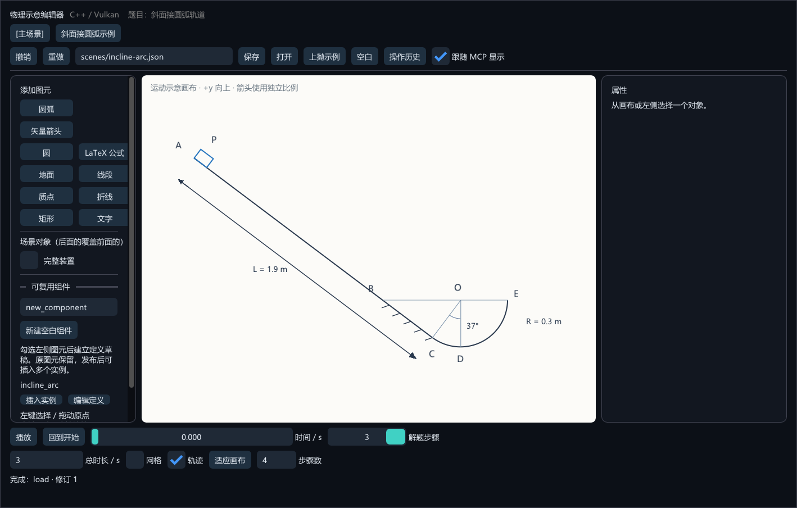
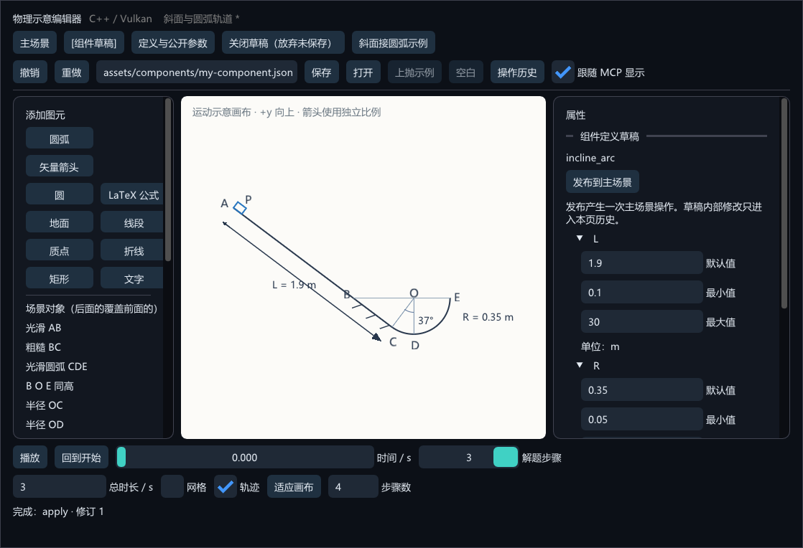
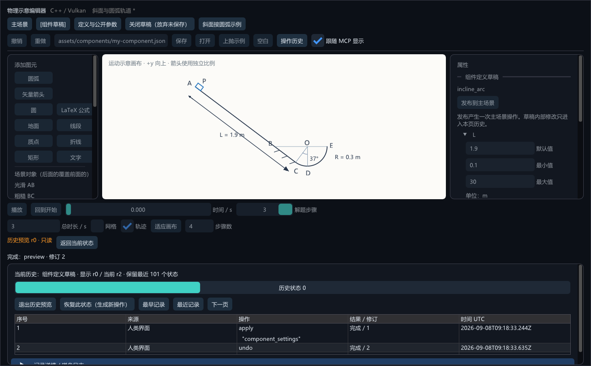

# 参数化组件与历史回溯（v0.2）

> v0.3 更新：[动画工作区与独立工程](animation-and-projects.md)。顶部改为菜单和工作区；工程保存包含场景、草稿和历史。下文保留基础文档/组件机制，场景 JSON 是交换格式。


## 用这道题验证编辑方式

点击顶部 **斜面接圆弧示例**，或从项目根目录运行：

```powershell
.\build\vs2022\bin\editor\Release\physics_editor.exe --scene scenes/incline-arc.json
```

画布包含物块 P、斜面 ABC、圆弧 CDE、圆心 O、光滑 AB、粗糙 BC，以及分步骤出现的同高线、半径、圆心角和长度标注。点击装置即可在右侧修改 `R`、`L`、`angle`（按 Enter 提交）；整个装置是一个实例，可以整体移动、旋转、等比缩放，也可以在左侧再次插入同一定义。



原 v0.1 可以用折线近似这幅图，但修改尺寸后需要逐项修正。v0.2 用圆弧图元和参数表达式消除了这部分重复操作。它还不是通用 CAD：自定义几何依赖目前需要编辑表达式，尚无鼠标点选“两线相切”等通用约束工具。

这道题涉及摩擦做功、机械能和圆周运动受力，已经超出纯运动学。几何组件只描述装置，不能直接承担动力学求解。此示例没有让物块沿圆弧运动；现有匀加速运动也不能直接用于完整圆弧轨道。

## 建立可复用组件

1. 在主场景左侧勾选若干静态图元，输入稳定英文 ID，点击“用勾选图元建立组件”。未勾选图元时可建立空白组件。已有原图元保留，草稿使用所选图元的原坐标作为局部坐标；不自动猜测新的中心。
2. 切换到“组件草稿”。这里有自己的画布、对象列表、文件路径、撤销栈和历史面板。可用与主场景相同的创建、修改、删除、移动命令编辑内部图元。
3. 在数值属性旁点击“公开”，建立参数及属性绑定。初始 min/max 都等于当前值，先在右侧“定义与公开参数”面板设置合理的 default/min/max（按 Enter 提交）；单位与复杂元数据在高级 JSON 区设置。复杂的几何依赖在高级 JSON 的 `bindings` 中填写表达式。
4. 绑定后的属性显示“参数驱动”，不能直接输入覆盖；位置由参数驱动的图元不能直接拖动。修改相应参数或绑定表达式即可改变它。
5. 点击“发布到主场景”，将完整定义快照写入主场景，所有引用这个定义 ID 的实例使用新定义。主场景只增加一次事务，可统一撤销。实例显式覆盖的参数值仍保留；若新定义不兼容现有参数，整次发布拒绝，两个文档均不发生部分提交。
6. 在主场景的组件列表点击“插入实例”，在右侧设置公开参数及整体变换。组件草稿内部修改不会自动发布。

定义与实例是两个概念。只把图元“分组”通常解决共同选择/移动；**参数化组件（组件定义 + 实例）**进一步解决复用、公开参数及定义更新。

组件草稿可独立保存为 JSON，示例定义位于 `assets/components/incline-arc.json`。导入另一个定义文件时，先新建具有相同 ID 的空白草稿，再在组件标签页打开该文件。当前只允许同时打开一个主场景和一个组件草稿；草稿 ID 在该会话内不可改变。界面的关闭按钮明确标注“放弃未保存”，MCP 默认拒绝关闭有未保存修改的草稿，发布不等于将草稿另存到资产文件。



## 参数格式与坐标约定

组件定义是带有额外 `componentDefinition` 字段的场景 JSON；内部图元使用局部坐标。以下是元数据示意，省略的 `objects` 中必须有对应的 `track`、`label` 图元：

```json
{
  "id": "incline_arc",
  "parameters": {
    "R": {"default": 0.3, "min": 0.05, "max": 10, "unit": "m"}
  },
  "bindings": [
    {"object": "track", "property": "radius", "expression": "R"},
    {"object": "label", "property": "text", "template": "R = {R} m"}
  ],
  "constraints": []
}
```

参数名是 ASCII 标识符。表达式支持数值、公开参数、`+ - * /`、括号及 `sin/cos/sqrt/abs`，其中三角函数使用**角度制**。不执行脚本，也不引用其他属性；这是有界的单向参数求值，不是联立约束求解器。`constraints` 中每个表达式必须大于零，否则拒绝参数更新。文本模板可以引用公开参数，普通未绑定的文本仍不会自动改写。

圆弧以圆心 `x/y`、`radius`、`start/end` 表达，角度从 +x 方向逆时针增加，扫过角度须在 `(0,360]`。实例变换按“等比缩放 → 旋转 → 平移”应用到内部图元。文字和公式的位置随变换，字形保持正向，字号与线宽保持屏幕尺寸，以便阅读；实例本身的 color/stroke 不覆盖内部风格。

当前限制：每个定义最多 128 个静态图元、32 个参数、512 个绑定；主场景最多 32 个定义。定义内暂不支持嵌套组件、独立运动和位置绑定，避免在第一版引入循环坐标依赖。可对整个实例添加现有匀加速运动。

本题几何以 O 为原点：

\[
C=(-R\sin\theta,-R\cos\theta),\quad
A=C+(-L\cos\theta,L\sin\theta),\quad
B=(-R/\sin\theta,0).
\]

因此 BC 与 OC 垂直，C 位于圆上，B/O/E 同高。要求 `L-R*cos(angle)/sin(angle)>0` 保证 A 位于 B 上方。画图使用实际 37° 三角函数；题目给出的 0.6/0.8 是求解时采用的近似值，二者不应混作一组精确几何常量。可复现资产生成入口为 `python assets/components/generate_incline.py`。

## 历史时间轴，而非运动时间轴

点击“操作历史”展开画布下方的面板。**拖动历史时间轴浏览（history scrubbing）**会切换到旧修订的只读画面，也可点击成功修改文档的记录进入该状态。



- “显示 r…”是历史游标，“当前 r…”是仍然保留的最新文档。滑块显示当前保留状态的序号，不是秒数。
- “退出历史预览”返回最新文档，不增加操作记录。
- “恢复此状态”将预览内容提交为一条新的可撤销操作，不删除后续审计日志。
- 预览期间暂停物理播放并禁用文档编辑/保存；可以平移、缩放和查看属性。历史回溯不会恢复此前的窗口布局或物理播放秒数。
- 每个文档保留最近 101 个历史状态、最多 100 步撤销；查询、历史游标变化、自动动画帧不写审计日志。记录已过保留期时会明确拒绝预览。

主场景和组件草稿历史**按文档作用域隔离**。这比“并行历史”更准确：不要求同时开两个线程，也不要求两个文档处在同一历史时刻。切换标签页后 Ctrl+Z 仅作用于该页。

日志分别写入 `history/session-*.jsonl` 和 `history/components/<草稿会话编号>/session-*.jsonl`。打开草稿建立新的历史基线，关闭后磁盘日志保留，但不保留该草稿的内存撤销栈。尚未实现跨会话历史回放或崩溃恢复。

## MCP 合同

文档相关工具接受 `scope: "scene" | "component"`，默认 `scene`；**不根据当前标签页猜测目标**。跟随显示开启时，成功操作会显示对应文档。

新增工具为 `open_component`、`close_component`、`publish_component`、`get_timeline`、`preview_history`、`restore_history`。发布同时校验 `expected_revision`（主场景）和 `component_revision`（草稿）。`get_scene.document` 始终返回最新文档；`displayRevision`、`previewing` 表示历史预览状态。`get_view_state.presentedScope/presentedRevision` 表示最近实际呈现的文档范围与修订。

UI 和 MCP 都通过 `Workspace → Document` 执行编辑，共用同一验证与记录规则。输入来源仍表示入口而非人类/AI 身份。打开/关闭草稿属于工作区生命周期操作；编辑日志记录各文档从其基线开始的操作，不把切换标签、选择对象、滚动画布混入文档撤销栈。
