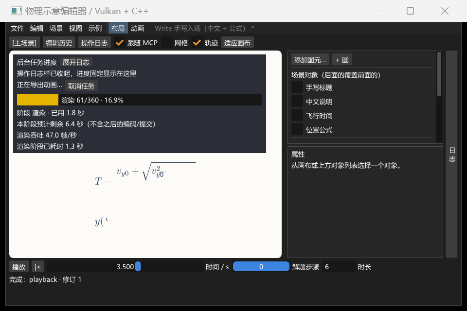

# 导出提速、操作日志与实时进度 · 2026-09-23

范围：优化离屏读回与 PNG 编码，新增右侧人类/MCP 操作日志和持续可见的后台任务进度；完成失败、取消和临时目录清理检查。正式程序仍由 `run-editor.ps1` / `run-editor-mcp.ps1` 从当前源码构建。

## 性能与画面

同一冻结的 Write 演示场景、Release、本机同一 GPU，分别导出 30 帧 PNG。性能测量关闭 validation，窗口与失败路径另开 validation / synchronization validation 验证。基线为 `0f2c14c`，表中的时间是帧生成耗时，**不包含 MP4 编码，不代表完整视频导出的加速比**。

| 尺寸 | 优化前 | 优化后 | 加速比 |
| --- | ---: | ---: | ---: |
| 1280×720 | 10.710 s | 0.647 s | 16.55× |
| 2560×1440 | 40.938 s | 1.148 s | 35.66× |

- 两种尺寸各 30 帧的 PNG SHA-256 前后全部一致。证据：`build/verification/render-benchmark-baseline/result.json` 与 `build/verification/render-benchmark-final-20260922/result.json`。
- 原来已经使用 Vulkan GPU 渲染；此次主要改善主机读回内存访问和 PNG 并行编码，没有改用 NVENC。编码队列有界，按保守工作内存估算限制线程数；该估算不是整个进程的硬内存上限。
- 实际可见窗口导出 MP4：2560×1440、60 fps、6.000 s、360 帧，端到端约 **10.43 s**（包含进度采样、截图与窗口操作）。视频参数经 ffprobe 核对。证据：`build/verification/current-ui-ce4853d336a24229af52e46323227d52/` 的 `report.json`、`write-2k.mp4` 与截图。

## 窗口与回归

- **Release 全量 25/25 通过，117.98 s**：`ctest --test-dir build/vs2022 -C Release --output-on-failure`。其中公式/导出 Python 全量 **166 项通过**。日志：`build/verification/2026-09-23-final-release.log`。
- **Debug 专项 6/6 通过，40.28 s**：`editor_smoke`、`editor_activity_log_live`、`editor_export_progress_live`、`editor_offscreen_failure`、`editor_write_rendering`、`editor_background_job`。日志：`build/verification/2026-09-23-final-debug.log`。本次不将其表述为 Debug 全量回归。
- 实际窗口核对右侧日志、成功/失败记录、后台任务进度、窄窗口和 F9 收起日志后的不透明进度浮层；播放条仍可见。包含调整窗口、最小化/恢复、正常关闭，父窗口和导出进程的 Vulkan / 同步校验无错误或警告。
- 操作日志独立于撤销历史；查询不刷屏。增量查询覆盖合并记录的更新、日志重置和旧记录淘汰。后台任务完成、失败、取消均有终态记录。
- 实际取消导出断言临时帧目录已删除；失败后进度同步为失败，不残留“编码中”。归属检查拒绝伪造记录、目标路径改写和目录联接越界，已提交输出保留。
- 写帧失败（含最后一帧）不会产生假成功；窗口缩放时离屏导出不借用窗口资源。后台进度测试改用有超时的样本确认，避免机器繁忙时仅靠固定休眠漏掉轮询；保留重复轮询、单调更新和读取限频断言。



范围限制：仅验证本机 Windows / NVIDIA GeForce RTX 4060 Laptop GPU，未验证其他设备与驱动。MP4 仍由 CPU libx264 编码，复杂场景的加速比需单独测量。预计剩余时间只针对当前阶段；超大倍率的文字/公式仍受光栅精度限制。无法确认归属或仍被外部占用的临时目录会保留并报告原因。

# 公式 Write 入场：结构/字形顺序 · 2026-09-16

范围：生成公式书写计划、C++ 编辑器消费与校验、工程兼容、实际渲染与导出。外层从左到右，分式按“分数线→分子→分母”展开，主体后跟上下标及常见装饰。文字路径与原 alpha 缓存保持不变；公式示例采用逐单元完成的节奏（`stagger=1`）。

## 已实测

- **Python 全量 121 项通过**：`python -B -m unittest discover -s tools -p "test_*.py"`。其中 `tools/test_formula_writing_plan.py` 37 项覆盖合成结构与归属、假 page 对象的**按对象标识归属**（包围盒重叠也不抢错）、真实 PDF 集成，以及内置计划表对 28 个缓存掩码的结构核对。
- **28 个内置公式全部生成计划**（`FAILURES: none`）且 `alphaSame=True`：重算的 `formula_cache.hpp` 与仓库文件逐字节相同，内置 alpha 缓存未变。
- **关键顺序**（紧页面路径，与运行时一致）：flight `T = [分数线] v y 0 + q v 2 y 0 + 2 g h 0 g`；aligned 两行 `a = [线] b c d = [线] e f`（两行互不认领）；`\frac{\frac{a}{b}}{c}` → `[线] [线] a b c`；`\frac{a}{\frac{b}{c}}` → `[线] a [线] b c`；`\sum_{i=1}^{n}i^2` 与 `\int_0^T` 的算子都先于上下限；`\vec v_0` → `v 箭头 0`；`\hat x` → `x 帽子`。
- 回归修复：aligned 里上下两行、x 跨度相同的独立分式曾被 `_nests` 互认成嵌套，根集合为空后顺序退回内容流；现要求嵌套间隙 <= 2 × 最近间隙，并跑两遍"归属↔嵌套"。
- **Release 构建完成，全量 21/21 通过，79.58 s**。日志：`build/verification/2026-09-16-formula-order-release.log`。覆盖原有功能、旧工程兼容、新运行时资源、窗口缩放/最小化/恢复/关闭和 Vulkan 校验。
- **Debug 构建完成，针对性 5/5 通过，40.18 s**：`editor_project`、`editor_smoke`、`editor_write_entry`、`editor_write_rendering`、`editor_runtime_assets`。日志：`build/verification/2026-09-16-formula-order-debug.log`。
- Release 与 Debug 的临近完成帧最大通道差均为 **2/255**，半程 `T` 与完成帧差均为 **1/255**。结果分别位于 `build/verification/write-render-4f474e51ee034e7a98d959bed32fa0c0` 和 `build/verification/write-render-d6ee8d5909ae405fb6226eea8a00381a`，窗口及导出 Vulkan 校验均为 0 错误、0 警告。
- 最终演示：`build/verification/write-demo/write-demo-1789529929869521000.mp4`，ffprobe 确认 6 s、30 fps、1280×720、180 帧；配套 `write-demo.physproj` 位于同目录。导出父进程和工作进程的 Vulkan 校验均为 0/0。
- 补上渲染器实际调用的内置计划查找测试；GPU 图像回归额外检查半程时 `T` 已完成，防止“生成表正确但渲染仍回退旧顺序”。仍保留临近完成帧最大通道差不超过 2/255 的检查。
- 逐帧检查 `build/verification/write-acceptance/frames-1789529636624714500` 的 2.0、2.125、2.25、3.0 s 帧，确认 `T =`、分数线、分子依次出现；文字效果保持原样。
- 已知限制：`\overbrace` 这类比内容更高的装饰会被当成主体；整式上横线与所在分子一起输出；带宽对规则线给 3.0 pt 容差；不做完整 TeX 语法解析。

# Write 手写入场验收 · 2026-09-15

范围：文字和 LaTeX 公式的轮廓描画、填充、纯时间求值，编辑器/MCP 共用 `set_write` 操作，历史与工程保存兼容。实现与示例位于主干。

## 实测结果

- `cmake --build --preset release` 完成；`ctest --test-dir build/vs2022 -C Release --output-on-failure` **21/21 通过**，69.49 s。包含文档/组件/历史、公式资源、MCP/stdio、导出和实际窗口检查。完整快照：`build/verification/2026-09-15-write-release.log`。
- Debug 编辑器及 `physics_write_entry_test` 编译成功；Debug 的 `editor_smoke`、`editor_write_rendering`、`editor_write_entry` **3/3 通过**，8.15 s。没有将本次结果表述为 Debug 全量测试。快照：`build/verification/2026-09-15-write-debug.log`。
- 新增 `editor_write_rendering` 使用独立 stdio 编辑器，检查前后 seek 在可见窗口实际呈现、不改变文档修订，并导出四帧。比较 t=0.1（write.duration=0.100001）与 t=0.15 的最终普通绘制：Release 与 Debug 的最大 8 位颜色通道差均为 **2**，3097 个通道有差异；允许的最大差为 2，不使用大面积误差比例掩盖字距跳动。中文区域逐像素一致，剩余为公式纹理插值量化。两个结果目录：`build/verification/write-render-e7a66e11d76a49db9c200300abdb43d0`（Release）、`build/verification/write-render-34ee647673f24fc6ab2e082fabc1d40a`（Debug）。
- 首版曾在同一检查中出现 max delta 172，第一轮修正后为 68；最终补齐纹理过滤支持区域后降为 2。该回归能检测实际观察到的缺陷，不只验证最终帧。
- 最终示例已导出 48 张 1280×720 PNG；人工检查 1.0 / 2.5 / 3.5 / 5.875 s 帧，确认中文逐字描边位置、公式入场过程和最终排版。帧目录：`build/verification/write-acceptance/frames-1789447019794539700`。临时帧检查脚本在导出后曾漏传保存用 expectedToken；正式回归与下面的演示工程保存均使用 token 并通过。
- 编辑器实际导出 **6 s、30 fps、1280×720、180 帧 MP4**，路径：`build/verification/write-demo/write-demo-1789447020930247600.mp4`；配套工程 `build/verification/write-demo/write-demo.physproj`。导出任务详情保存在该目录的 `result.json`。
- 实际窗口、同步校验及导出子进程的 Vulkan 验证均为 **0 错误、0 警告**。窗口冒烟检查覆盖缩放、最小化/恢复、关闭；图像回归的主窗口在保存后正常关闭（退出码 0）。

## 实现与取舍

文字轮廓由固定 64 px 光栅提取，再映射至当前字体的真实包围盒与字距；填充复用原图集。公式将所有有覆盖的 texel 及其一圈双线性过滤支持邻域独占分配给各区域，用原 alpha 纹理绘制，保留软边缘与孔洞；弱灰度区域不会丢失。CPU 回归检查非零位置偏移、断开的轮廓、过滤支持域、弱笔画、孔洞、时间边界和序列化。

该效果接近 Manim Write 的轮廓描画方式，不是汉字真实笔顺。公式按遮罩区域的空间顺序出现，不解析 LaTeX 的逻辑推导顺序。只有弱灰度且未达到描边阈值的区域保留填充、没有轮廓描边；组件定义仍为静态图元。高倍率放大仍受光栅精度限制。

# 主干入口整理 · 2026-09-14

- 正式目录 `build/vs2022/bin/editor/Release/physics_editor.exe` 已从当前源码重新构建；`editor_smoke`、`editor_mcp`、`editor_stdio` 3/3 通过，26.12 s，窗口验证 0 错误 / 0 警告。快照日志：`build/verification/2026-09-14-canonical-editor.log`。
- `run-editor-mcp.ps1` 在 Windows PowerShell 5.1 和 PowerShell 7 下实际完成增量构建、MCP 初始化/工具发现、可见窗口与画布检查；日志分别为 `build/verification/powershell-editor-launcher.log` 与 `pwsh-editor-launcher.log`。MCP stdout 能由官方客户端严格解析，构建与诊断走 stderr。
- 启动脚本构建失败时不启动旧程序，项目路径引号和退出码透传经隔离替身检查；脚本语法与 VS Code 任务 JSON 检查通过。普通窗口入口与 MCP 入口共用 `build-editor.ps1`。
- 旧审查工作树与重复编辑器程序已清理。以下旧验收记录的临时程序路径是历史位置；CTest 的 `LastTest.log` 会被后续运行覆盖，正式入口与本次证据以上述快照为准。

# v0.4 验收收尾 · 2026-09-14

范围：完成编辑器缺陷修复的最终回归与专项验收，并复核先前 Debug 全量日志。Release 全量与两种配置的专项验收于 2026-09-14 执行；结果归档后仅调整文档，未重复构建。

## 实测结果

- **Debug 最终全量 19/19 通过**：`build/vs2022/Testing/Temporary/LastTest.log`（2026-09-10 16:04–16:06）逐项为 `Test Passed`，含 `platform_png_writer` 0.07 s、`platform_font_support` 0.04 s、`cube_math` 0.03 s、`cube_smoke` 1.51 s、`editor_project` 1.53 s、`editor_animation` 0.08 s、`editor_document` 0.10 s、`editor_components` 0.47 s、`editor_runtime_paths` 0.10 s、`editor_animation_smoke` 4.25 s、`editor_smoke` 2.54 s、`editor_component_smoke` 2.93 s、`editor_mcp` 8.64 s、`editor_stdio` 19.64 s、`editor_formula_worker` 8.21 s、`editor_runtime_assets` 26.95 s、`editor_background_job` 1.57 s、`kinematics_model` 0.03 s、`kinematics_smoke` 2.33 s。五个 smoke 用例（`cube_smoke`、`editor_animation_smoke`、`editor_smoke`、`editor_component_smoke`、`kinematics_smoke`）的日志均为 `Validation errors: 0; warnings: 0`。
- **Release 全量 19/19 通过**：`ctest --test-dir build/verify-runtime -C Release --output-on-failure` 退出码 0，19/19，67.38 s（`build/verify-runtime/Testing/Temporary/LastTest.log`，2026-09-14 16:57–16:58），含 `editor_formula_worker` 8.49 s、`editor_stdio` 16.72 s、`editor_runtime_assets` 22.42 s、`editor_mcp` 7.62 s、`editor_background_job` 1.57 s；五个 smoke 的验证与同步计数同为 0 错误 0 警告。
- **`mcp/test_defect_acceptance.py`（R1/R2/A2/A4/U4）**：Debug 与 Release 均退出码 0。R2 的离屏光栅在两种配置下都是请求 57.4206 px → 实际 58 px，2560 px PNG 存在且非单色，工作进程日志 `Validation errors: 0; warnings: 0`；U4 以 121 s × 30 fps = 3630 帧触发明确拒绝（错误信息含 `3600`、无输出文件、文档时长保持 121 s）。证据 `build/defect-acceptance/acceptance-2a472c9e9e7f44dbb25e984692bb7d50.log`（Debug）、`acceptance-35716ad5fae24287aff6be85e588c294.log`（Release），样张 `r2-frames-<uuid>/frame_000000.png`。
- **U2 真实平移/缩放**：`editor_smoke` 在真实画布上注入滚轮缩放与中键拖动，`get_view_state` 的 `zoom`/`origin`/`pan` 确实变化，同时 `get_project.dirty` 仍为 false（`apps/editor/editor.cpp::smokeInput` / `smokeAfterFrame`）。`editor.cpp` 修改于 16:03:27、`physics_editor.exe` 构建于 16:03:42，均早于 16:04 开始的该轮测试，断言随 Debug 与 Release 的 `editor_smoke` 通过。
- **U3 真实拖色一条历史并撤销**：`editor_smoke` 点击打开真实 `ColorEdit4` 弹窗，在弹窗内按住拖动三帧后松开，断言颜色已改变、文档 revision 只 +1、`history.lastId` 只 +1，随后 undo 恢复拖动前颜色；Debug 与 Release 的 `editor_smoke` 均通过。
- **A1 / A3 / U5 的运行断言**：位于 `mcp/test_runtime_assets.py`（只读核对）——A1 断言 `canvasReady`、正画布尺寸、`viewportSource=presented` 与 `presented`/`view`（live）分离、`origin` 两分量、`zoom>0`；A3 断言 `fit` 使用请求尺寸的独立取景、`current` 匹配画布时宽高为偶数且 ≥16、`fit` 配 `width=height=0` 明确拒绝；U5 断言编码器缺失时导出失败但工作进程 `worker.log` 保留、编辑器进程仍存活，导出期间窗口缩放/最小化恢复继续，取消导出不退出前端。Debug 与 Release 的 `editor_runtime_assets` 均通过。
- **U1 工作区夹取**：`placeWindowInWorkArea` 的 CPU 用例（`src/platform/font_support_test.cpp`，随 `platform_font_support` 通过）覆盖常规工作区、工作区小于期望尺寸、负坐标副屏与退化 1×1 工作区；本机窗口生命周期由 smoke 覆盖（日志 `Window: 1440x960 at 560,284 (work area 2560x1528, minimum 960x640)`）。这不构成完整逐显示器 DPI 矩阵。
- **文案校正**：资源指纹的类型标签与长度标记只消除此前确定性的结构混淆（同为空容器、空串与 null 折叠成同一哈希输入），不承诺 FNV-1a 64 位绝无碰撞；早期 `editor_smoke` 失败原因是 JSON 空值初始化，不是空指针；A5 只描述当前实现下客户端需刷新/重连才能看到新增工具，不断言协议层无法推送工具列表变化。

## 范围与限制

- 仅本机 Windows 10.0.22631 / NVIDIA GeForce RTX 4060 Laptop GPU 与当前驱动；未验证其他 GPU/驱动与跨平台，不构成完整逐显示器 DPI 矩阵。
- 最终 Release 全量命令由外部正式审批权限执行；本机沙箱内 shell 写 `build/` 受限，与产品行为无关。

## 保留约束（本轮不变）

- R3：超出 `referenceZoom` 的缩放仍是位图字形/公式遮罩放大，画面会变软，属已文档化的固有代价。
- R4：组件实例 `scale` 不改变文字/公式字号与线宽。
- R5：受限 LaTeX 不含 CJK，公式图元只放数学，中文与公式混排需拆成“文字图元 + 公式图元”。
- U6：旧分支错误单摆资产（`pend_radial = F_T=mg\cos\theta`）未引入；若要重做，绳张力径向通式为 `T = mg cosθ + mv²/l`。
- 旧导出分支不可整体合并（见 [分支审查](reviews/2026-09-09-branches.md)）。

# v0.4 验证记录 · 2026-09-09

范围：运行时数学 LaTeX（后台编译、工程内资产、撤销/冲突/保存重开/跨工程隔离）、整体统一缩放、独立固定尺寸 PNG/MP4/GIF 导出。

- 构建：沿用 checked-in `vs2022` 生成器与 MSVC x64，没有替换工具链。Release 使用同生成器的独立目录 `build/verify-runtime`（`CMAKE_GENERATOR=Visual Studio 17 2022`、x64），避免重建并关闭用户正在使用的 `build/vs2022` Release 窗口；Debug 使用 `build/vs2022`。两者的 `PHYSICS_FORMULA_PYTHON` 指向装有 Pillow/pypdfium2 的解释器，该路径只写入本机 CMake 缓存，不提交。
- Release 三项定向测试全部通过（最新日志 `build/verify-runtime/Testing/Temporary/LastTest.log`，2026-09-09 18:11）：
  - `editor_mcp`：MCP 生命周期/编辑、原子性、历史来源与撤销关联、磁盘日志、实际呈现修订、自动恢复与可见渲染、正常 Vulkan 关闭；新增 `set_formula`/`export_animation`/`get_job`/`cancel_job` 工具发现与非法 LaTeX 拒绝。
  - `editor_formula_worker`：`tools` 下 83 项受限公式排版与导出事务单元测试通过。
  - `editor_runtime_assets`：运行期 LaTeX、拒绝/冲突/撤销、工程重开、PNG/MP4/GIF 独立尺寸与时长、父窗口缩放/最小化恢复期间继续导出、编码器缺失不退出前端、取消、组件草稿导出、跨工程资产隔离。
- 导出证据（`build/verification/runtime-8bbc3c7f531d4a008c5323b19fcdb194`）：PNG 4 帧均 1280×720；MP4/GIF 320×180，MP4 时长 1.000s；`frames=ceil(时长×fps)=4` 且 `requestedDuration=1.0`，无静默缩短；组件草稿 PNG 320×180。每个原生导出进程的 `worker.log` 均为 `Validation errors: 0; warnings: 0`，且无 `[Vulkan]` 行。
- 视觉检查：`build/verification/formula-fix-inspect/formulas-fixed.png`（分式、根式、上标、cases 完整）、`frames/frame_000000.png` 与 `frame_000003.png`（场景与公式完整、首末帧不同）、`component-frames/frame_000000.png`（固定尺寸）。这些截图与日志是本地产物，不进入 Git。
- 资源隔离：`baseline.physproj` 含 28 个内置遮罩、无自定义；`portable.physproj` 含 28 个内置资产和 1 个自定义资产（带 LaTeX 源文本）。重开 portable 后公式仍可用；再打开 baseline 后不再包含上一个工程的自定义资产。
- Debug 最终补测（`build/vs2022`，2026-09-09 23:19）：三项定向测试 3/3 通过，合计 35.71s，日志 `build/vs2022/Testing/Temporary/LastTest.log`。本轮由 Codex 经正式 `require_escalated` 审批执行（获批的正式运行，非绕过沙箱）；测试使用独立 pipe，未连接、未关闭用户正在使用的 `build/vs2022` Release 窗口。
  - `editor_mcp`（8.29s）：MCP 生命周期/编辑、原子性、历史来源与撤销关联、磁盘日志、实际呈现修订、自动恢复与可见渲染、正常 Vulkan 关闭。
  - `editor_formula_worker`（7.03s）：`tools` 下 83 项受限公式排版与导出事务单元测试（`Ran 83 tests`，`OK`）。
  - `editor_runtime_assets`（20.39s）：运行期 LaTeX、拒绝/冲突/撤销、工程保存后重开、PNG/MP4/GIF 时长与尺寸、缩放/最小化恢复期间继续导出、编码器缺失不退出前端、取消、组件草稿导出、跨工程资产隔离。
  - 该轮产物 `build/verification/runtime-b51ed867b6fe4f42b94adbad9e052418`：两个原生导出进程的 `runtime-*.log` 均为 `Validation errors: 0; warnings: 0`，`swapchain builds: 3`、`minimized skips: 0`，覆盖窗口缩放、最小化/恢复与正常关闭。
  - 范围与限制：仅本机 Windows / NVIDIA RTX 4060 Laptop GPU；Release 三项已于 18:11 覆盖同一份源码与最终脚本，本轮未重复。
- 范围与限制：仅本机 Windows / NVIDIA GPU；未验证其他 GPU/驱动、超长动画、矢量导出或跨会话自动恢复。4096×4096 导出的 PNG 编码峰值约 0.5 GB，属已知资源成本（未做压测，无失败证据）。

## 主干兼容修复验证 · 2026-09-09

- `editor_project`：Debug / Release 均通过，新增检查库的增量兼容、变化遮罩拒绝、保留新资源、非法缩放基准拒绝且工作区不变。
- Debug `physics_editor` 构建成功，`editor_mcp` 接口回归通过；原生测试进程正常关闭，Vulkan 错误与警告均为 0。
- 本轮没有修改 GPU 资源生命周期，未重复旧版本的全量窗口测试。分支导出审查在独立目录进行，不能把它的常规测试结果算成主干新增导出功能。

# v0.3 验证记录 · 2026-09-08

- MSVC / CMake 预设 Debug、Release 构建成功。
- 两种配置的 8 项编辑器测试全部通过：document、components、animation、project，三个原生窗口测试（基础、组件、动画），以及官方 MCP SDK 集成。
- 最终菜单布局调整后，两种配置的 4 项 GUI/MCP 测试再次通过；核心代码未变化。
- 三个原生测试各呈现 120 帧，重建交换链 4 次，覆盖缩放、最小化/恢复、关闭销毁；Vulkan 验证与同步验证均为 0 错误 / 0 警告。
- 新动画测试使用真实 ImGui 鼠标/键盘事件：拖动关键帧只提交一次、Ctrl+Z 撤销、MCP 时间同步、F(t) 非线性箭头，以及运行时除零的暂停/提示。
- 工程测试包含：搬移文件后用全新 Workspace 加载、超过 1000 条审计不截断、独立组件草稿的重做、已关闭草稿归档、历史预览、损坏草稿拒绝且场景不变、过期 MCP 工程令牌拒绝。
- 查看了实际截图的完整窗口、缩小窗口和公式错误状态。截图使用 SDK screenshot 层，单独运行中的 2 条显式加载层提示与正式零警告测试分开。
- 最后去掉选中箭头的重复名称，解决与说明文字重叠；两种配置的动画窗口测试重新通过，正式日志仍为 0 错误 / 0 警告，截图已更新。
- 已备份旧窗口场景并恢复到新发布版，另存 `projects/` 下的独立工程。旧 JSON 不包含旧撤销栈，旧 JSONL 日志继续保留在本地。
- 本轮未修改平台渲染资源所有权，未重跑立方体/运动学示例；这里报告编辑器的验证范围。

本地日志：`build/verification/editor-v03-debug.log`、`editor-v03-release.log`、`editor-v03-final-ui-debug.log`、`editor-v03-final-ui-release.log`。MCP 原生销毁检查另见 `build/mcp-editor-test.log`。


以下保留旧版本验证记录。

# 本机验证记录

## 参数化组件与历史回溯 v0.2（2026-09-08）

- Debug / Release 均成功构建。最终编辑器回归各 5 项：`editor_document`、`editor_components`、`editor_smoke`、`editor_component_smoke`、`editor_mcp`。本轮还执行过两种配置的全量 9 项测试，原立方体和运动学示例继续通过。
- `editor_components` 检查多组 R/倾角下 C 在圆上、BC 与 OC 垂直、B/O/E 同高；参数范围、几何组合约束、错误表达式和单位类型拒绝；组件变换与多个实例；草稿/场景历史隔离；一次发布事务；回溯不改 head、恢复可撤销、日志恢复来源及 101 个状态上限。
- `editor_component_smoke` 在实际 Win32/Vulkan 窗口中注入鼠标按下、移动、释放，验证组件整体拾取/拖动、历史滑块按下和连续拖动；再验证组件页的人类 Ctrl+Z 不消费主场景历史。它与原 editor_smoke 均覆盖 120 帧、4 次交换链构建、缩放和最小化恢复及正常销毁。
- 官方 MCP SDK 客户端连接真实原生进程，验证 18 个工具中的场景编辑、参数化资产加载、组件草稿/主场景日志隔离、发布、状态预览/恢复、各 scope 的实际呈现修订、最小化后的显示恢复、中文路径持久化和关闭清理。
- 正式运行 Vulkan + 同步验证均为 **0 错误 / 0 警告**。Debug 最终相关测试日志保存在 `build/verification/editor-v02-debug.log`；Release 全量和最终相关日志分别为 `editor-v02-release.log`、`editor-v02-release-final.log`。这些运行产物不进入 Git。
- 实际截图使用 SDK 的 `VK_LAYER_LUNARG_screenshot` 捕获 `--component-smoke` 呈现帧；截图辅助运行有 2 条显式加载截图层的 loader 提示，与正式零警告测试分开。检查了正常大小、缩小窗口、组件参数页和只读历史预览；示意图与历史列表可以同时看到。
- 已打开的旧版 Release 曾占用可执行文件。更新前通过本地接口保存并比对场景备份，再正常关闭。恢复文件与播放状态位于 `build/upgrade/`，旧日志留在 `history/`。不将临时恢复文件作为项目示例提交。

限制：本轮未验证其他 GPU、长时间大文档压力、跨会话自动恢复、嵌套组件或轨道动力学。图片展示的是参数化几何示意，不代表已经求解该题或完成沿轨道的物理动画。


## 同步窗口与统一操作日志（2026-09-08）

- Debug、Release 均通过 `editor|kinematics` 的 5 项相关测试，正式运行的 Vulkan / 同步校验均为 0 错误、0 警告。
- 真实 MCP 集成测试验证：窗口可见、已呈现帧递增、已呈现修订与修改后的文档一致；最小化后通过 MCP 定位到 0.8 秒会恢复窗口并呈现该时间的状态；显式 show_editor 也能恢复窗口。
- 鼠标创建/拖动后，smoke 通过 MCP 来源的共用命令入口修改同一对象，再注入人类 Ctrl+Z，验证撤销结果与日志中的跨来源关联。真实管道/协议另由 MCP 集成测试覆盖。
- 核心和集成测试验证日志来源、拒绝记录、撤销/重做关联、分页、会话初始状态和 JSONL 落盘。查询和自动播放不增加操作日志。
- 已检查 `docs/editor-history-preview.png`，来自 SDK 截图层捕获的实际 UI；截图辅助运行的两条 loader 提示与正式零警告运行分开记录。
- 暂不支持跨会话日志浏览 UI、日志自动回放和重启后的撤销恢复。来源字段表示界面/MCP 输入通道，不是对人或 AI 身份的认证。

---

## 编辑器 v0.1（2026-09-08）

- Debug 全量构建成功；7 项 CTest 全部通过。
- Release 编辑器、场景核心和运动学示例构建成功；`editor|kinematics` 的 5 项测试全部通过。
- 关闭两个示例，使用独立构建目录编译 Release `physics_editor` 成功。
- 编辑器 smoke 注入鼠标事件验证添加圆、画布拖动、未保存退出提示的取消；随后验证命令历史与窗口缩放、最小化恢复、退出。
- 官方 MCP 客户端真实连接原生窗口，覆盖握手、9 个工具发现、创建/移动、原子失败回滚、旧修订拒绝、未知公式拒绝、撤销/重做、时间轴、中文路径保存/打开、工作区路径限制和最小化时的请求响应。
- 正式 Vulkan 与同步检查，包含资源销毁阶段，均为 `Validation errors: 0; warnings: 0`。
- SDK 截图层捕获了动画第 15/40/70 帧；已检查编辑器实际图像，预览存于 `docs/editor-preview.png`。截图辅助运行额外产生两条 loader 加载提示；不计入上述正式测试结果。
- MCP 已注册为 `physics-editor`，实际启动参数由 `codex mcp get physics-editor` 核对。自动启动流程通过真实客户端验证。当前宿主会在客户端进程结束后回收子窗口，不承诺该窗口跨宿主退出继续存在。
- Windows 入口使用宽字符命令行并转换为 UTF-8；已使用包含中文工作区及中文文件名的绝对 `--scene` 路径跑完 120 帧 smoke，同步校验 0 错误、0 警告。最终入口重新编译后，Release 的 3 项编辑器测试再次通过。
- `scenes/vertical-throw.json` 经真实 MCP 客户端的 `save_scene` 工具生成；默认场景包含 13 个可编辑对象。

验证范围仍限本机 Windows / NVIDIA GPU；未测试跨平台、其他 GPU、长时间压力、设备丢失恢复或第三方插件热加载。

---

验证日期：2026-09-07。所有构建及 GPU 测试均在当前电脑执行。

## 环境

| 项目 | 实测结果 |
| --- | --- |
| 操作系统 | Windows 10.0.22631 |
| CMake | 4.4.2 |
| Visual Studio | 2022，MSBuild 17.11.9 |
| C++ 编译器 | MSVC 19.41.34120，x64 |
| Windows SDK | 10.0.22621.0 |
| Vulkan SDK | 1.4.341.1 |
| GPU | NVIDIA GeForce RTX 4060 Laptop GPU |
| GPU Vulkan API | 1.4.329 |
| NVIDIA 驱动 | 596.36 |
| 呈现扩展 | 支持 VK_EXT_swapchain_maintenance1，功能已显式开启 |

## 构建与测试

```powershell
cmake --preset vs2022
cmake --build --preset debug
ctest --preset debug --verbose
cmake --build --preset release
ctest --test-dir build/vs2022 -C Release --verbose
```

- Debug 和 Release 均编译成功，MSVC `/W4` 编译输出未报告警告。
- 两种配置的测试均为 **2 / 2 通过**。
- `cube_math` 验证近远裁剪面的 Vulkan 深度范围、宽高比、Y 翻转、旋转方向与模型/视图变换顺序。
- `cube_smoke` 在真实 GPU 上启用 `VK_LAYER_KHRONOS_validation`，并通过 `VK_LAYER_VALIDATE_SYNC=1` 启用同步验证。
- 每种配置均成功绘制并呈现 120 帧，创建交换链 4 次，覆盖初始窗口、方形窗口、竖屏窗口和最小化后的恢复。
- 暂停/恢复、方向调整、复位与退出路径通过程序内控制状态检查；不宣称已用外部 UI 自动化逐一按键验证。
- 清理资源后，最终回调统计均为 **Validation errors: 0; warnings: 0**。
- CTest 从示例的构建目录启动程序，着色器仍正常加载，验证了不依赖当前工作目录。

最终 GPU 日志摘要：

```text
Validation: enabled
GPU: NVIDIA GeForce RTX 4060 Laptop GPU
Swapchain: 984x721 (3 images)
Swapchain: 704x681 (3 images)
Swapchain: 524x761 (3 images)
Swapchain: 524x761 (3 images)
Pause/resume/reset: passed
Rendered frames: 120; swapchain builds: 4; minimized skips: 1
Validation errors: 0; warnings: 0
```

## 图像检查

使用 SDK 自带的 `VK_LAYER_LUNARG_screenshot` 从实际呈现帧捕获了横向、近方形和竖向窗口的图像。人工查看了横向与竖向图像：立方体完整可见，面颜色分明，前后遮挡正确。README 的预览来自该程序的实际渲染帧，不是概念图。

截图辅助运行会产生两条 loader 提示，内容是通过 `VK_INSTANCE_LAYERS` 加载截图层；这与不加载截图层的正式同步测试分开记录。最终正常测试的警告数为 0。

原始截图及详细测试日志位于 `build/captures/` 和 `build/vs2022/Testing/Temporary/`；可重复运行测试生成新记录。预览保存在 `docs/cube-preview.png`。

## 验证边界

尚未验证其他 GPU/驱动、非 Windows 系统、设备丢失恢复或长时间压力运行。当前实现是一个独立学习示例，设计取舍见 `learning-notes.md`。
