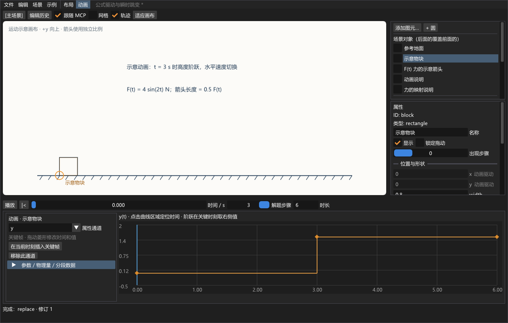
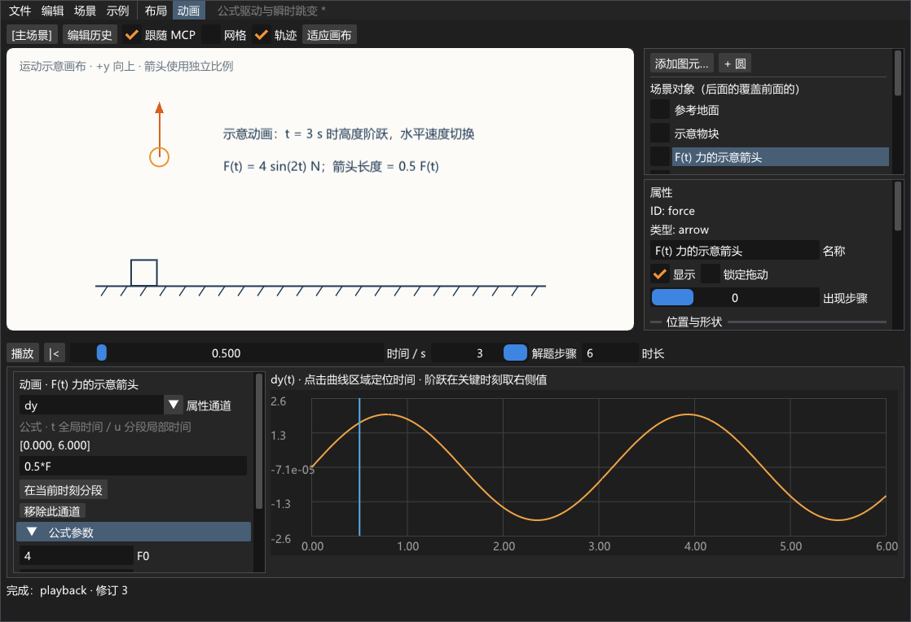

# 主干兼容修复验证 · 2026-09-09

- `editor_project`：Debug / Release 均通过，新增检查库的增量兼容、变化遮罩拒绝、保留新资源、非法缩放基准拒绝且工作区不变。
- Debug `physics_editor` 构建成功，`editor_mcp` 接口回归通过；原生测试进程正常关闭，Vulkan 错误与警告均为 0。
- 本轮没有修改 GPU 资源生命周期，未重复旧版本的全量窗口测试。分支导出审查在独立目录进行，不能把它的常规测试结果算成主干新增导出功能。

# v0.3 验证记录 · 2026-09-08

- MSVC / CMake 预设 Debug、Release 构建成功。
- 两种配置的 8 项编辑器测试全部通过：document、components、animation、project，三个原生窗口测试（基础、组件、动画），以及官方 MCP SDK 集成。
- 最终菜单布局调整后，两种配置的 4 项 GUI/MCP 测试再次通过；核心代码未变化。
- 三个原生测试各呈现 120 帧，重建交换链 4 次，覆盖缩放、最小化/恢复、关闭销毁；Vulkan 验证与同步验证均为 0 错误 / 0 警告。
- 新动画测试使用真实 ImGui 鼠标/键盘事件：拖动关键帧只提交一次、Ctrl+Z 撤销、MCP 时间同步、F(t) 非线性箭头，以及运行时除零的暂停/提示。
- 工程测试包含：搬移文件后用全新 Workspace 加载、超过 1000 条审计不截断、独立组件草稿的重做、已关闭草稿归档、历史预览、损坏草稿拒绝且场景不变、过期 MCP 工程令牌拒绝。
- 查看了实际截图的完整窗口、缩小窗口和公式错误状态。截图使用 SDK screenshot 层，单独运行中的 2 条显式加载层提示与正式零警告测试分开。
- 最后去掉选中箭头的重复名称，解决与说明文字重叠；两种配置的动画窗口测试重新通过，正式日志仍为 0 错误 / 0 警告，截图已更新。
- 已备份旧窗口场景并恢复到新发布版，另存 `projects/` 下的独立工程。旧 JSON 不包含旧撤销栈，旧 JSONL 日志继续保留在本地。
- 本轮未修改平台渲染资源所有权，未重跑立方体/运动学示例；这里报告编辑器的验证范围。

本地日志：`build/verification/editor-v03-debug.log`、`editor-v03-release.log`、`editor-v03-final-ui-debug.log`、`editor-v03-final-ui-release.log`。MCP 原生销毁检查另见 `build/mcp-editor-test.log`。





以下保留旧版本验证记录。

# 本机验证记录

## 参数化组件与历史回溯 v0.2（2026-09-08）

- Debug / Release 均成功构建。最终编辑器回归各 5 项：`editor_document`、`editor_components`、`editor_smoke`、`editor_component_smoke`、`editor_mcp`。本轮还执行过两种配置的全量 9 项测试，原立方体和运动学示例继续通过。
- `editor_components` 检查多组 R/倾角下 C 在圆上、BC 与 OC 垂直、B/O/E 同高；参数范围、几何组合约束、错误表达式和单位类型拒绝；组件变换与多个实例；草稿/场景历史隔离；一次发布事务；回溯不改 head、恢复可撤销、日志恢复来源及 101 个状态上限。
- `editor_component_smoke` 在实际 Win32/Vulkan 窗口中注入鼠标按下、移动、释放，验证组件整体拾取/拖动、历史滑块按下和连续拖动；再验证组件页的人类 Ctrl+Z 不消费主场景历史。它与原 editor_smoke 均覆盖 120 帧、4 次交换链构建、缩放和最小化恢复及正常销毁。
- 官方 MCP SDK 客户端连接真实原生进程，验证 18 个工具中的场景编辑、参数化资产加载、组件草稿/主场景日志隔离、发布、状态预览/恢复、各 scope 的实际呈现修订、最小化后的显示恢复、中文路径持久化和关闭清理。
- 正式运行 Vulkan + 同步验证均为 **0 错误 / 0 警告**。Debug 最终相关测试日志保存在 `build/verification/editor-v02-debug.log`；Release 全量和最终相关日志分别为 `editor-v02-release.log`、`editor-v02-release-final.log`。这些运行产物不进入 Git。
- 实际截图使用 SDK 的 `VK_LAYER_LUNARG_screenshot` 捕获 `--component-smoke` 呈现帧；截图辅助运行有 2 条显式加载截图层的 loader 提示，与正式零警告测试分开。检查了正常大小、缩小窗口、组件参数页和只读历史预览；示意图与历史列表可以同时看到。
- 已打开的旧版 Release 曾占用可执行文件。更新前通过本地接口保存并比对场景备份，再正常关闭。恢复文件与播放状态位于 `build/upgrade/`，旧日志留在 `history/`。不将临时恢复文件作为项目示例提交。

限制：本轮未验证其他 GPU、长时间大文档压力、跨会话自动恢复、嵌套组件或轨道动力学。图片展示的是参数化几何示意，不代表已经求解该题或完成沿轨道的物理动画。


## 同步窗口与统一操作日志（2026-09-08）

- Debug、Release 均通过 `editor|kinematics` 的 5 项相关测试，正式运行的 Vulkan / 同步校验均为 0 错误、0 警告。
- 真实 MCP 集成测试验证：窗口可见、已呈现帧递增、已呈现修订与修改后的文档一致；最小化后通过 MCP 定位到 0.8 秒会恢复窗口并呈现该时间的状态；显式 show_editor 也能恢复窗口。
- 鼠标创建/拖动后，smoke 通过 MCP 来源的共用命令入口修改同一对象，再注入人类 Ctrl+Z，验证撤销结果与日志中的跨来源关联。真实管道/协议另由 MCP 集成测试覆盖。
- 核心和集成测试验证日志来源、拒绝记录、撤销/重做关联、分页、会话初始状态和 JSONL 落盘。查询和自动播放不增加操作日志。
- 已检查 `docs/editor-history-preview.png`，来自 SDK 截图层捕获的实际 UI；截图辅助运行的两条 loader 提示与正式零警告运行分开记录。
- 暂不支持跨会话日志浏览 UI、日志自动回放和重启后的撤销恢复。来源字段表示界面/MCP 输入通道，不是对人或 AI 身份的认证。

---

## 编辑器 v0.1（2026-09-08）

- Debug 全量构建成功；7 项 CTest 全部通过。
- Release 编辑器、场景核心和运动学示例构建成功；`editor|kinematics` 的 5 项测试全部通过。
- 关闭两个示例，使用独立构建目录编译 Release `physics_editor` 成功。
- 编辑器 smoke 注入鼠标事件验证添加圆、画布拖动、未保存退出提示的取消；随后验证命令历史与窗口缩放、最小化恢复、退出。
- 官方 MCP 客户端真实连接原生窗口，覆盖握手、9 个工具发现、创建/移动、原子失败回滚、旧修订拒绝、未知公式拒绝、撤销/重做、时间轴、中文路径保存/打开、工作区路径限制和最小化时的请求响应。
- 正式 Vulkan 与同步检查，包含资源销毁阶段，均为 `Validation errors: 0; warnings: 0`。
- SDK 截图层捕获了动画第 15/40/70 帧；已检查编辑器实际图像，预览存于 `docs/editor-preview.png`。截图辅助运行额外产生两条 loader 加载提示；不计入上述正式测试结果。
- MCP 已注册为 `physics-editor`，实际启动参数由 `codex mcp get physics-editor` 核对。自动启动流程通过真实客户端验证。当前宿主会在客户端进程结束后回收子窗口，不承诺该窗口跨宿主退出继续存在。
- Windows 入口使用宽字符命令行并转换为 UTF-8；已使用包含中文工作区及中文文件名的绝对 `--scene` 路径跑完 120 帧 smoke，同步校验 0 错误、0 警告。最终入口重新编译后，Release 的 3 项编辑器测试再次通过。
- `scenes/vertical-throw.json` 经真实 MCP 客户端的 `save_scene` 工具生成；默认场景包含 13 个可编辑对象。

验证范围仍限本机 Windows / NVIDIA GPU；未测试跨平台、其他 GPU、长时间压力、设备丢失恢复或第三方插件热加载。

---

验证日期：2026-09-07。所有构建及 GPU 测试均在当前电脑执行。

## 环境

| 项目 | 实测结果 |
| --- | --- |
| 操作系统 | Windows 10.0.22631 |
| CMake | 4.4.2 |
| Visual Studio | 2022，MSBuild 17.11.9 |
| C++ 编译器 | MSVC 19.41.34120，x64 |
| Windows SDK | 10.0.22621.0 |
| Vulkan SDK | 1.4.341.1 |
| GPU | NVIDIA GeForce RTX 4060 Laptop GPU |
| GPU Vulkan API | 1.4.329 |
| NVIDIA 驱动 | 596.36 |
| 呈现扩展 | 支持 VK_EXT_swapchain_maintenance1，功能已显式开启 |

## 构建与测试

```powershell
cmake --preset vs2022
cmake --build --preset debug
ctest --preset debug --verbose
cmake --build --preset release
ctest --test-dir build/vs2022 -C Release --verbose
```

- Debug 和 Release 均编译成功，MSVC `/W4` 编译输出未报告警告。
- 两种配置的测试均为 **2 / 2 通过**。
- `cube_math` 验证近远裁剪面的 Vulkan 深度范围、宽高比、Y 翻转、旋转方向与模型/视图变换顺序。
- `cube_smoke` 在真实 GPU 上启用 `VK_LAYER_KHRONOS_validation`，并通过 `VK_LAYER_VALIDATE_SYNC=1` 启用同步验证。
- 每种配置均成功绘制并呈现 120 帧，创建交换链 4 次，覆盖初始窗口、方形窗口、竖屏窗口和最小化后的恢复。
- 暂停/恢复、方向调整、复位与退出路径通过程序内控制状态检查；不宣称已用外部 UI 自动化逐一按键验证。
- 清理资源后，最终回调统计均为 **Validation errors: 0; warnings: 0**。
- CTest 从示例的构建目录启动程序，着色器仍正常加载，验证了不依赖当前工作目录。

最终 GPU 日志摘要：

```text
Validation: enabled
GPU: NVIDIA GeForce RTX 4060 Laptop GPU
Swapchain: 984x721 (3 images)
Swapchain: 704x681 (3 images)
Swapchain: 524x761 (3 images)
Swapchain: 524x761 (3 images)
Pause/resume/reset: passed
Rendered frames: 120; swapchain builds: 4; minimized skips: 1
Validation errors: 0; warnings: 0
```

## 图像检查

使用 SDK 自带的 `VK_LAYER_LUNARG_screenshot` 从实际呈现帧捕获了横向、近方形和竖向窗口的图像。人工查看了横向与竖向图像：立方体完整可见，面颜色分明，前后遮挡正确。README 的预览来自该程序的实际渲染帧，不是概念图。

截图辅助运行会产生两条 loader 提示，内容是通过 `VK_INSTANCE_LAYERS` 加载截图层；这与不加载截图层的正式同步测试分开记录。最终正常测试的警告数为 0。

原始截图及详细测试日志位于 `build/captures/` 和 `build/vs2022/Testing/Temporary/`；可重复运行测试生成新记录。预览保存在 `docs/cube-preview.png`。

## 验证边界

尚未验证其他 GPU/驱动、非 Windows 系统、设备丢失恢复或长时间压力运行。当前实现是一个独立学习示例，设计取舍见 `learning-notes.md`。
